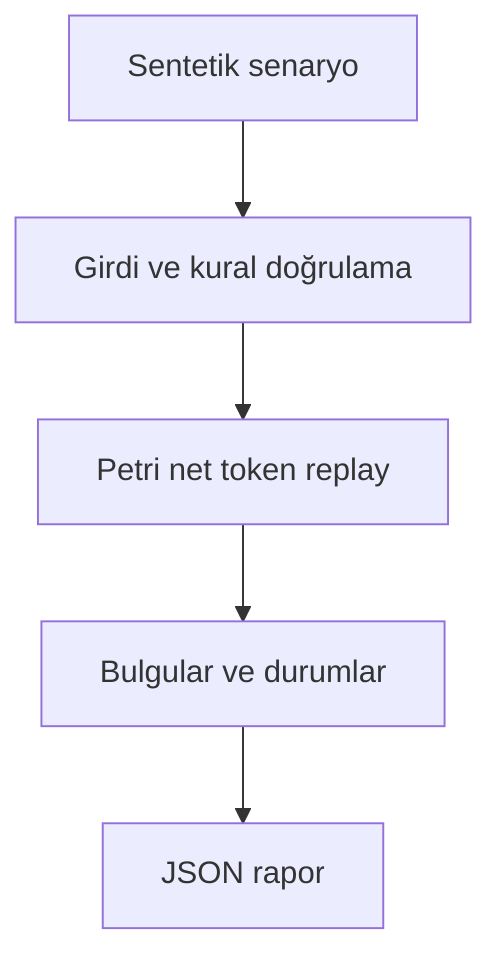

# Mimari

İşlem günlüklerinin zorunlu süreç adımlarını atlayıp atlamadığını açıklamalı biçimde ölçmek.

Asıl alan akışı: **PetriNet.replay → missing tokens → final marking → variants**. CLI JSON yükler, çekirdek `run(config)` alan motorunu çağırır ve JSON seri hale getirir. Veritabanı kullanan örnekler geçici dizinde izole edilir; kalıcı sınıflar doğrudan çağrılırken dosya yolu dışarıdan verilir.

## İnvariant ve başarısızlık sınırı

Eksik giriş jetonları sanal olarak eklenir ve ihlal sayılır; sonuç fit bayrağı ve fitness birlikte okunur.

Optimal alignment algoritması değildir; zaman ve kaynak kuralları ayrıca modellenmelidir.

Her hata kararı makine tarafından okunabilir çıktı veya açık exception üretir. Geçersiz yapılandırma sessizce düzeltilmez. Olası tekrarların güvenliği ilgili çekirdeğin kabul kurallarına bağlıdır; bütün projelere ortak bir retry uygulanmaz.
